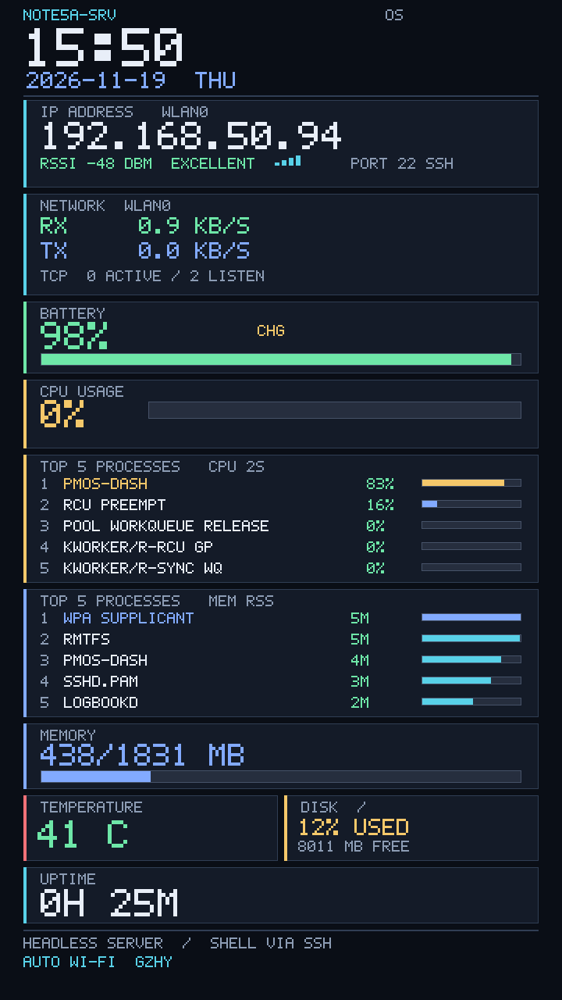

# Redmi Note 5A → postmarketOS 无头 Linux 服务器

> 把一台 Redmi Note 5A（代号 `ugglite`，高通 MSM8917/MSM8937，postmarketOS 通用端口 `qcom-msm89x7`）改造成可持续运行的 headless Linux 服务器。
>
> 本仓库记录**构建 → 刷机 → 联网 → SSH → 图形仪表盘 → 电源键控制**的完整实测流程，供同型号或同芯片设备复现。所有步骤均在真机验证通过（2026-11-19）。



---

## 一、最终成果

| 项目 | 实测值 |
|---|---|
| 系统 | postmarketOS `edge` / 主线内核 `7.1.3-msm89x7` / OpenRC / Alpine 用户态 |
| 设备端口 | `qcom-msm89x7`（aarch64），屏幕 720×1280 |
| 网络 | Wi-Fi 开机自连（`wpa_supplicant` + `udhcpc`），IP 由路由器 DHCP 分配 |
| 远程 | SSH 密钥 + 密码登录（user / root），`sshd` 开机自启 |
| 应急通道 | USB CDC-ACM 串口（COM?，115200），**不依赖任何网络、无需驱动签名** |
| 本地 UI | 开机全屏 framebuffer 仪表盘（时间/IP/RSSI/网速/电量/CPU/内存/Top5…） |
| 交互 | 短按电源键切换亮灭屏，长按留给内核关机 |

**注意**：早期曾评估"Android 原生 chroot Alpine"作为备选路线（见 `docs/05`），它**不是**本仓库的最终方案。最终方案是刷入真正的 postmarketOS。

---

## 二、复现路线图（按顺序阅读）

| 阶段 | 文档 | 内容 |
|---|---|---|
| 0 | [`docs/00-快速复现指南.md`](docs/00-快速复现指南.md) | ⭐ **从零到一的权威步骤**，先看这篇 |
| 1 | [`docs/01-设备诊断报告.md`](docs/01-设备诊断报告.md) | ADB 探测设备信息、解锁状态、前置条件 |
| 2 | [`docs/02-postmarketOS适配分析.md`](docs/02-postmarketOS适配分析.md) | 官方适配状态、功能矩阵、`lk2nd` 依赖 |
| 3 | [`docs/03-实施手册-改造为Linux服务器.md`](docs/03-实施手册-改造为Linux服务器.md) | 备份 / 构建 / 刷机 / 无头配置的完整手册 |
| 4 | [`docs/06-实测执行记录与踩坑.md`](docs/06-实测执行记录与踩坑.md) | ⭐ 真实踩坑 19 条（GitLab 迁移、代理、固件、串口…） |
| 5 | [`docs/07-设备端配置参考.md`](docs/07-设备端配置参考.md) | 全部 `local.d` 脚本、Wi-Fi/gadget/仪表盘配置模板 |
| 6 | [`dashboard/README.md`](dashboard/README.md) | 仪表盘与电源键守护进程的编译、部署、抓图 |
| 7 | [`docs/04-运维与故障排查.md`](docs/04-运维与故障排查.md) | 功耗、存储、日常运维、回滚、常见问题 |

`docs/05-已实施-Android原生chroot服务器.md` 是**备选/历史方案**，仅在无法刷机时参考。

---

## 三、前置条件

- Redmi Note 5A（ugglite），**Bootloader 已解锁**
- 一台 Linux / WSL2 主机用于 `pmbootstrap` 构建
- Windows 主机装 `adb` / `fastboot`（USB 直通 WSL 不可靠，刷机在 Windows 侧做）
- 网络（构建需下载约 1 GB；国内建议配置代理，见 `docs/06` 坑 12）
- 认真备份数据 —— **刷机会清除 `/data`**

---

## 四、脱敏说明（重要）

仓库中所有个人/环境相关信息均已用占位符替换，复现时请替换为**你自己的值**：

| 占位符 | 含义 |
|---|---|
| `<DEVICE_IP>` | 设备局域网 IP（路由器 DHCP 分配或固定） |
| `<YOUR_WIFI_SSID>` / `<YOUR_WIFI_PASSWORD>` | 你的 Wi-Fi 名称与密码 |
| `<TEMP_PASSWORD>` / `<YOUR_PASSWORD>` | 临时安装密码 / 你自设的登录密码 |
| `<DEVICE_SERIAL>` | `adb devices` 里的设备序列号 |
| `<DEVICE_MAC>` | 设备 Wi-Fi MAC |
| `<PROXY_HOST>:<PROXY_PORT>` | 你的代理地址（如不需要可删除） |
| `<GATEWAY_IP>` / `192.168.1.0/24` | 你的网关 / 网段示例 |

配置模板集中放在 [`config/`](config/)，可直接改好后 `scp` 到设备。

---

## 五、目录结构

```
.
├── config/                      # 脱敏后的设备端配置模板（可直接 scp 部署）
│   ├── 50-wifi.start            #   开机自动连 Wi-Fi
│   ├── 60-timesync.start        #   NTP 对时
│   ├── 70-dashboard.start       #   仪表盘自启
│   ├── 80-pwrkey.start          #   电源键亮灭屏守护
│   ├── wpa-auto.conf.example    #   wpa_supplicant 配置
│   └── pmbootstrap_v3.cfg.example # 构建配置
├── dashboard/                   # framebuffer 仪表盘 + 电源键守护进程源码
│   ├── pmos-dash.c
│   ├── pwrkey-blank.c
│   ├── inject-pwrkey.c          #   uinput 测试工具（仅调试）
│   ├── fb2png.py                #   raw framebuffer → PNG
│   └── preview*.png             #   效果截图（v1/v2/v3/满载/修复后）
├── docs/                        # 分阶段文档（00–07）
├── scripts/
│   ├── windows/                 #   ADB 诊断、备份、SSH 验收、运维控制台
│   ├── linux/                   #   pmbootstrap 构建、内核下载、Wi-Fi 注入
│   └── device/                  #   chroot 备选路线脚本（历史）
└── README.md
```

---

## 六、快速命令（已部署设备）

```bash
# SSH 登录（替换为你的 IP 与密钥）
ssh -i ~/.ssh/id_ed25519 user@<DEVICE_IP>

# 查看自动连网日志
sudo tail -f /var/log/wifiauto.log

# 查看仪表盘 / 电源键日志
sudo tail -f /var/log/pmos-dash.log
sudo tail -f /var/log/pwrkey-blank.log

# 重启仪表盘
sudo /etc/local.d/70-dashboard.start
```

Windows 侧也可运行 `scripts/windows/03-srvctl.ps1 status`（先按你的环境修改其中的 IP）。

---

## 许可与致谢

- 设备适配数据来自 [postmarketOS Wiki — Xiaomi Redmi Note 5A (xiaomi-ugglite)](https://wiki.postmarketos.org/wiki/Xiaomi_Redmi_Note_5A_(xiaomi-ugglite)) 与 pmaports `qcom-msm89x7` 端口。
- 本项目文档按实测整理，供同型号设备爱好者参考。刷机有风险，操作前请完整备份。
